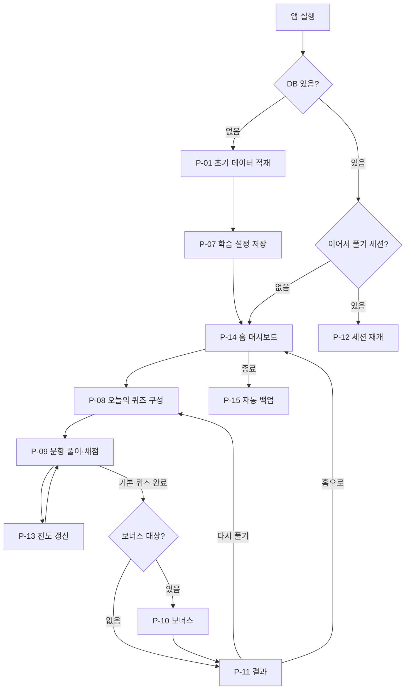

# 스마트보카 기능 프로세스 설계서

**파일 위치**: `docs/설계_261118_기능 프로세스 설계서 v0.5.md`
**작성일**: 2026-11-25
**버전**: v0.5
**설명**: 방법론 2장의 프로세스 설계서(Process Logic). 단위 기능별 처리 순서, 알고리즘 기준, 트랜잭션 경계, 예외 처리를 정의한다. 규칙 수치는 요구사항 명세서 v1.9, 저장 구조는 데이터 설계서 v1.8, 모듈·함수 시그니처는 시스템 구조 설계서 v1.7을 정본으로 하고, 여기서는 FR 번호와 설계 절 번호로만 참조한다.

---

## 1. 목적과 범위

- **목적**: 기능마다 시스템이 무슨 순서로 판정하고 저장하는지 한 곳에서 정의한다. 개발자는 이 문서로 처리 순서를, 설계서로 함수 구조를 본다.
- **범위**: FR-1.1 ~ FR-4.2 전체와 앱 시작·종료 흐름. 화면 배치는 UI 설계서, 함수 시그니처는 시스템 구조 설계서가 담당한다.
- **표기**
  - `[ ]` 안은 저장 대상 테이블과 컬럼
  - `▶` 은 분기
  - `FR-x.x`는 규칙의 정본 위치
  - `UI x.x`는 화면 설계의 위치

## 2. 전체 학습 흐름

## 3. 프로세스 목록

| ID | 프로세스 | 관련 FR | 트리거 |
|----|----------|---------|--------|
| P-01 | 앱 시작과 초기 데이터 적재 | FR-1.1, FR-2.1 | 앱 실행 |
| P-02 | 단어 목록 조회 | FR-1.2, FR-4.2 | 단어 메뉴 진입, 검색·필터·정렬 변경 |
| P-03 | 단어 추가 | FR-1.3, FR-1.7 | [+ 추가] |
| P-04 | 단어 수정 | FR-1.7 | 상세 보기 [수정] |
| P-05 | 단어 삭제 | FR-1.4 | [✕] 또는 상세 보기 [삭제] |
| P-06 | 예문 조회와 추가 | FR-1.5, FR-1.6 | 상세 보기 열기, 예문 추가 |
| P-07 | 학습 설정 저장 | FR-2.1, FR-2.2 | 설정 메뉴 [저장] |
| P-08 | 오늘의 퀴즈 구성 | FR-3.1, FR-3.2 | [퀴즈 시작하기] |
| P-09 | 문항 풀이와 채점 | FR-3.2, FR-3.3 | 보기 선택 |
| P-10 | 보너스 제시 | FR-3.4 | 기본 퀴즈 전체 완료 |
| P-11 | 결과 확인과 재풀이 | FR-3.5, FR-3.3-A | 마지막 문항 완료, [다시 풀기] |
| P-12 | 세션 중단·재개·그만하기 | FR-3.6 | 앱 종료, [이어서 풀기], [그만하기] |
| P-13 | 진도 갱신 | FR-3.3-A, FR-4.0 | 반영 대상 답변 저장 |
| P-14 | 홈 대시보드 집계 | FR-4.1 | 홈 진입, 진도 변경 후 |
| P-15 | 백업·복구 | FR-1.8 | 설정의 백업·복구 버튼, 앱 종료 |

---

## 4. 프로세스 상세

### P-01 앱 시작과 초기 데이터 적재

**입력**: 앱 실행
**처리**
1. DB 파일 존재 여부 확인
2. DB가 없으면 초기화를 진행한다.
   1. CSV 두 파일(`words_common.csv`, `words_business.csv`)을 읽는다 (열: english, korean_meaning, category, level, example_1~3)
   2. **검증을 먼저 한다**: 분야는 일상·비즈니스·미분류 중 하나, level은 1~5 정수, 영어 중복 없음. 빈 분야는 `미분류`, 빈 level은 1로 채운다
   3. ▶ 검증 실패 시 DB 파일을 만들지 않고 CSV 오류를 안내한다. 재시도할 수 있는 상태로 둔다
   4. 검증을 통과하면 DB 파일을 만들고 `PRAGMA foreign_keys = ON`을 켠 뒤 테이블을 만든다
   5. **한 트랜잭션**으로 다음을 저장한다
      - 단어 1,500개 `[Word]` (일상 1,000 / 비즈니스 500)
      - 예문: `example_1~3`을 `source = builtin`으로 저장한다. 빈 칸은 건너뛴다 `[Example]`
      - 학습 기록 1,500개: 미학습, 횟수 0, 정답률 NULL `[Progress]`
      - 기본 설정: 분야 선택안함, 학습량 10 `[Settings]`
      - 스키마 버전 기록 `[DBVersion]`
   6. ▶ 적재 중 오류가 나면 전체를 롤백하고 DB 파일을 지운다. 다음 실행 때 다시 시도한다
3. DB가 있으면 무결성을 확인한다
   - ▶ 손상이면 데이터베이스 오류 대화상자를 띄운다 (UI 2.6: 백업 복구·초기화·닫기)
4. ▶ 방금 DB를 만든 경우(첫 실행): 설정 화면을 띄우고, P-07 저장 후 홈으로 간다 (UI 3.1)
5. ▶ 그 밖의 경우: 홈으로 간다 → P-14

**출력**: 메인 윈도우와 첫 화면
**규칙 참조**: FR-1.1, 데이터 설계서 5.1

### P-02 단어 목록 조회

**입력**: 검색어, 분야 필터, 정렬 기준, 페이지 번호
**처리**
1. 기본값으로 목록을 연다 (분야 전체, 단어순, 1페이지)
2. 검색어가 있으면 단어 또는 뜻에 포함된 항목만 남긴다
3. 분야 필터를 적용한다 (일상 / 비즈니스 / 미분류 / 전체)
4. 정렬을 적용한다. 시도 0인 단어는 모든 정렬에서 맨 뒤에 둔다 (FR-1.2)
5. 20개씩 나누어 보여 주고, 상태를 색 배지와 글자로 표시한다
   - ▶ 결과가 0건이면 빈 목록 안내를 띄운다

**출력**: 목록 화면. 데이터는 바뀌지 않는다.
**규칙 참조**: FR-1.2, FR-4.2, UI 2.4

### P-03 단어 추가

**입력**: 영어(필수), 한글(필수), 분야(기본 미분류), 난이도(기본 1)
**처리**
1. 입력 폼을 띄운다
2. 저장 요청 시 영어의 앞뒤 공백을 제거하고 중복을 검사한다 (대소문자 무시)
   - ▶ 중복이면 중복 대화상자를 띄우고 저장하지 않는다. 입력값은 유지한다
3. 단어와 학습 기록을 한 트랜잭션으로 저장한다 `[Word]`, `[Progress]` (미학습)
4. 목록에 즉시 반영한다

**출력**: 목록에 새 단어 표시
**참고**: 새 단어에는 예문이 없다. 상세 보기에서 입력을 안내한다 (FR-1.5)
**규칙 참조**: FR-1.3, FR-1.7-A, 데이터 설계서 2.1

### P-04 단어 수정

**입력**: 영어, 한글, 분야, 난이도
**처리**
1. 상세 보기의 [수정]으로 기존 값을 채운 폼을 띄운다
2. 저장 요청 시 영어 중복을 검사한다. 자기 자신은 제외한다
   - ▶ 중복이면 경고를 띄우고 저장하지 않는다
3. `[Word]`를 갱신한다. `[Progress]`와 `[Example]`은 그대로 둔다
4. ▶ 취소하면 변경 없이 상세 보기로 돌아간다

**규칙 참조**: FR-1.7, FR-1.7-A

### P-05 단어 삭제

**입력**: 삭제할 단어
**처리**
1. 삭제 확인 대화상자를 띄운다. 학습 기록과 예문도 함께 삭제된다고 안내한다 (UI 2.6)
2. ▶ [취소]이면 변경 없이 닫는다
3. [삭제]이면 `[Word]`를 지운다. 연결된 `[Example]`, `[Progress]`, `[Quiz]`는 함께 지운다 (CASCADE)
4. ▶ 진행 중인 퀴즈 세션에 이 단어가 있으면 그 문항을 건너뛴다 (FR-3.6, UI 2.3.5)

**규칙 참조**: FR-1.4

### P-06 예문 조회와 추가

**입력**: 단어, 학생이 입력한 예문
**처리 (조회)**
1. 상세 보기를 열면 `[Example]`을 모두 보여 준다. 출처는 기본(builtin) / 사용자(user)로 표시한다
2. ▶ 예문이 3개 미만이면 "예문이 부족합니다. 직접 추가해 보세요" 안내와 입력칸을 보여 준다
3. 외부 사전이나 인터넷은 사용하지 않는다

**처리 (추가)**
1. ▶ 입력이 공백만이면 [추가]를 비활성화한다
2. ▶ 같은 단어에 글자 그대로 같은 문장이 이미 있으면 저장하지 않는다 (데이터 설계서 2.2)
3. `[Example]`을 `source = user`로 저장하고 목록에 즉시 추가한다
4. 사용자 예문만 삭제할 수 있다. 기본 예문은 삭제 대상이 아니다

**규칙 참조**: FR-1.5, FR-1.6

### P-07 학습 설정 저장

**입력**: 분야(일상 / 비즈니스 / 선택안함), 일일 학습량(5 / 10 / 15 / 커스텀 1~50)
**처리**
1. 설정 메뉴를 열면 현재 값을 보여 준다
2. 분야와 학습량을 고른다. 미분류는 설정 대상이 아니다
   - ▶ 저장 시 학습량이 1~50 밖이거나 분야 값이 허용 목록에 없으면 저장하지 않는다 (설계 4.11 `settings_service`)
3. ▶ 변경이 없으면 [저장]을 비활성화한다. 첫 실행 때는 예외로 항상 활성화한다 (FR-2.1, UI 2.5)
4. [저장]하면 `[Settings]`를 갱신한다
5. 홈의 분야 표시에 즉시 반영한다

**적용 시점**: 다음 "퀴즈 시작"부터 적용한다. 진행 중인 세션은 시작할 때의 값을 유지한다.
**규칙 참조**: FR-2.1, FR-2.2

### P-08 오늘의 퀴즈 구성

**입력**: 설정된 학습량 N, 분야, 오늘 날짜, 학습 기록
**처리**
1. 분야 필터를 적용한다. 선택안함이면 전체를 대상으로 한다
2. ▶ 등록 단어(전체)가 4개 미만이면 퀴즈를 시작하지 않고 안내한다 (UI 2.3.1)
3. ▶ 오늘 기본 퀴즈를 이미 끝냈으면 [다시 풀기] 안내를 띄운다 → P-11 재풀이 경로
4. 버킷별 개수를 정한다: 자주 틀린 `floor(N×0.10)`, 복습 대상 `floor(N×0.20)`, 신규·약한 단어는 나머지 (FR-3.1-B)
5. 버킷 순서대로 단어를 뽑는다: 자주 틀린 → 복습 대상 → 신규·약한 (FR-3.1-C). 이미 뽑은 단어는 다음 버킷에서 제외한다
   - **자주 틀린**: 정답률 < 60, 마지막 복습일이 7일 이상 전. 정답률 오름차순
   - **복습 대상**: 복습 예정일이 오늘 이하. 예정일 오름차순
   - **신규·약한**: 학습 상태가 `미학습` 또는 `학습중`인 단어. 자주 틀린 단어와 복습 대상으로 이미 뽑힌 단어는 제외한다 (FR-3.1-A). 숙달 단어는 넣지 않는다
   - 뜻 중복: 같은 한글 뜻의 단어(예: `hour`와 `time`이 모두 '시간')는 먼저 고른 쪽만 남긴다. 고른 뜻은 누적해 두고, 뒤 버킷과 부족분 보충도 같은 집합으로 거른다 (동의어 중복 방지, ADR-08)
6. ▶ 버킷이 모자라면 남는 개수를 신규·약한 단어에서 채우고, 그래도 모자라면 나머지 단어(숙달 포함)에서 무작위로 채운다 (FR-3.1-D)
7. 선정이 끝나면 한글 뜻이 겹치는 문항이 없는지 한 번 더 확인한다 (ADR-08)
8. 문항 유형을 나눈다: 한→영과 영→한 (N이 홀수면 영→한이 1개 많다)
9. 문항마다 보기 3개를 채운다 (아래 "보기 채우기" 참조)
   - ▶ 보기 후보가 3개 미만이면 그 문항을 제외한다
10. 문항 순서를 무작위로 정한다
11. ▶ 최종 문항 수가 N보다 적으면 "오늘 퀴즈는 N개 중 M개입니다"를 안내한다
12. [퀴즈 시작하기]를 누르면 `[QuizSession]`을 만들고 P-09로 간다

**보기 채우기** (정답 뜻과 같은 단어는 모든 단계에서 제외)
1. 같은 분야이고 난이도 차가 1 이하인 단어
2. 같은 분야의 단어 (난이도 조건 해제)
3. 전체 단어 중 무작위

- 각 단계에서 정답과 같은 한글 뜻인 단어는 제외한다. 보기끼리도 같은 뜻이면 한 개만 쓴다
- 세 단계를 거쳐도 보기가 3개가 안 되면 그 문항을 제외한다 (설계 4.4, 호출자가 문항을 뺀다)

**출력**: 세션 시작 전 준비 화면(문항 구성 요약), 세션 생성 후 첫 문항
**규칙 참조**: FR-3.1, FR-3.1-A ~ F, FR-3.2, UI 2.3.1

### P-09 문항 풀이와 채점

**입력**: 학생이 고른 보기
**처리**
1. 문항을 보여 준다 (세션에 저장된 문항과 보기를 그대로 사용)
2. 보기를 고르면 즉시 채점한다
3. **답변 한 건을 한 트랜잭션으로 저장한다** (데이터 7.3, 설계 5.1)
   - `[Quiz]`에 한 행을 남긴다: word_id, quiz_type, is_correct, is_bonus, is_retry, 날짜
   - 진도 반영 대상이면 `[Progress]`를 갱신한다 (P-13)
   - `[QuizSession]`의 현재 위치를 한 칸 올린다
   - Quiz만 저장되고 Progress가 저장되지 않으면 통계가 어긋나므로, 셋 중 하나라도 실패하면 셋 모두 되돌린다
   - 재풀이·보너스 답변은 `[Quiz]` 행과 세션 위치만 저장하고 `[Progress]`는 건드리지 않는다
4. 결과를 보여 준다: 정답이면 ✓, 오답이면 ✗와 정답 강조. 보기 4개는 모두 비활성화한다
5. [다음 문제]를 누르면 2번으로 돌아간다. 마지막 문항이면 [완료]로 P-11에 간다
   - 답변마다 즉시 저장하므로 중단해도 이전 답변은 남는다 (FR-3.6)

**규칙 참조**: FR-3.2, FR-3.3, FR-3.6, UI 2.3.2

### P-10 보너스 제시

**트리거**: 기본 퀴즈 N문항을 모두 끝냈을 때
**처리**
1. 대상을 고른다: 정답률 < 60% 이고 마지막 복습일이 7일 이상 전인 단어
2. 오늘 기본 퀴즈에 나온 단어와, 기본 퀴즈와 한글 뜻이 같은 단어는 제외한다
3. 정답률이 낮은 순, 같으면 마지막 복습일이 오래된 순으로 정렬하고 최대 5개를 뽑는다
4. ▶ 대상이 0개이면 보너스 화면을 건너뛰고 P-11로 간다
5. ▶ 대상이 있으면 보너스 안내를 띄운다: [보너스 도전하기] / [건너뛰기]
6. 도전하면 P-09와 같은 방식으로 풀되 `is_bonus = true`로 기록한다. 진도는 반영하지 않는다
7. 건너뛰면 P-11로 간다

**규칙 참조**: FR-3.4, 데이터 설계서 4.3, UI 2.3.3

### P-11 결과 확인과 재풀이

**입력**: 세션의 답변 기록
**처리**
1. 결과를 모은다: 정답 수 / 전체 수, 정답률, 오늘 완료 수, 전체 진도(학습 완료 / 전체 단어)
2. 결과 화면에 [다시 풀기], [단어 관리], [홈으로]를 보여 준다
3. 퀴즈를 끝까지 풀었으므로 `[QuizSession]`을 삭제한다 (FR-3.6)
4. ▶ [다시 풀기]이면 새 세션을 만든다. 재풀이로 표시하고(`is_retry`), 진도가 바뀌지 않는다는 안내를 띄운다 → P-08 준비 화면
5. ▶ [홈으로]이면 P-14로 간다

**규칙 참조**: FR-3.5, FR-3.3-A, UI 2.3.4, UI 3.4

### P-12 세션 중단·재개·그만하기

**처리**
1. 세션을 시작하면 `[QuizSession]`에 단일 레코드를 만든다 (문항 목록, 현재 위치)
2. 답변마다 `[Quiz]`와 진도를 즉시 저장하고 현재 위치를 갱신한다
3. 앱을 닫거나 비정상 종료해도 세션은 남는다
4. 다음 실행 시 홈에 [이어서 풀기]를 보여 준다. 퀴즈 메뉴를 열 때도 이어서 풀기 화면을 먼저 보여 준다 (UI 2.3.5)
5. [이어서 풀기]를 누르면 저장된 문항과 보기 그대로 이어서 푼다
   - ▶ 세션의 단어가 삭제되었으면 그 문항은 건너뛴다 (UI 2.3.5)
6. [그만하기]를 누르면 확인 대화상자를 띄운다 (UI 2.6)
   - ▶ 확인하면 `[QuizSession]`을 지우고 홈으로 간다. 이미 답한 `[Quiz]` 기록은 남긴다
7. 자정을 넘긴 세션은 시작한 날짜 기준으로 이어 풀고, 새로 시작하는 퀴즈는 오늘 기준으로 구성한다

**규칙 참조**: FR-3.6, 데이터 설계서 2.5

### P-13 진도 갱신

**입력**: 정답 여부, 날짜, 세션 종류(기본 / 재풀이 / 보너스)
**처리**
1. 반영 대상을 판정한다
   - 같은 날 첫 세션에서 푼 문항은 반영한다
   - 재풀이(`is_retry`)와 보너스(`is_bonus`)는 반영하지 않는다
   - 재풀이 세션 판정 기준은 FR-3.3-A에 있다
2. ▶ 반영 대상이 아니면 `[Quiz]` 기록만 남기고 끝낸다
3. 반영 대상이면 `[Progress]`를 갱신한다
   - 정답이면 정답 횟수와 연속 정답을 올린다. 오답이면 오답 횟수를 올리고 연속 정답을 0으로 한다
   - 마지막 복습일을 오늘로 바꾼다
   - 정답률을 다시 계산한다 (시도 0이면 NULL)
4. 연속 정답 횟수에 따라 다음 복습 예정일을 정한다 (FR-4.0 간격 표)
5. 상태를 판정한다 (FR-4.0 판정 순서): 시도 0 → 미학습, 연속 정답 5회 이상 → 숙달, 마지막 결과가 오답이거나 복습 예정일이 지남 → 복습필요, 그 밖에는 학습중

**규칙 참조**: FR-3.3-A, FR-4.0, 데이터 설계서 2.3

### P-14 홈 대시보드 집계

**트리거**: 홈 진입, 답변 저장 후, 설정 변경 후, 단어 추가·삭제 후
**처리**
1. 전체 진도율을 계산한다: 숙달 단어 수 ÷ 전체 단어 수
2. 분야별 진도를 계산한다 (항상 펼쳐 보여 준다)
3. 오늘 학습할 단어 수를 정한다. 퀴즈를 시작하기 전에는 설정값 N, 구성 후에는 구성된 문항 수
4. 어제 완료 문항 수와 오늘 진행(완료 / 구성)을 계산한다
5. ▶ 세션이 있으면 [이어서 풀기], 없으면 [퀴즈 시작하기] 버튼을 보여 준다
6. ▶ 단어가 0개이면 요약 카드 자리에 "단어를 추가해 주세요" 안내를 보여 준다

**출력**: 홈 화면. 데이터는 바뀌지 않는다.
**규칙 참조**: FR-4.1, 데이터 설계서 4.4, UI 2.2

### P-15 백업·복구

**수동 백업**
1. [백업 만들기]를 누른다
2. DB 파일을 `backups/manual_YYYYMMDD_HHMMSS.db`로 복사한다. 저장 위치는 사용자가 고르지 않는다
3. 완료 메시지에 저장 경로를 보여 준다

**복구**
1. [백업에서 복구]를 누르고 백업 목록에서 파일을 고른다
2. 파일을 검증한다. ▶ 스마트보카 DB가 아니거나 손상되었으면 복구를 거부하고 안내한다 (UI 2.6)
3. 확인 대화상자를 띄운다. 현재 학습 기록이 백업 내용으로 바뀐다고 안내한다
4. [복구]를 확인하면 현재 DB를 `pre_restore_*.db`로 먼저 백업한 뒤 복원한다
5. 홈 화면을 갱신한다

**백업 방식 (공통)**: 파일을 그대로 복사하지 않고 SQLite 백업 API를 쓴다. 앱이 DB를 열고 있는 동안 복사하면 일관성이 깨질 수 있기 때문이다 (데이터 5.2)

**자동 백업 (앱 종료 시)**
1. 종료 요청을 받으면 진행 중인 세션은 지우지 않고 유지한다 (P-12)
2. `backups/auto_YYYYMMDD_HHMMSS.db`를 만든다
3. 자동 백업은 최근 3개만 남기고 오래된 것부터 지운다. 수동 백업과 복구 전 백업은 지우지 않는다
4. DB 연결을 닫고 종료한다

**복구 시스템 단계 (위 사용자 단계 2~5의 상세)**
1. 선택한 파일이 SQLite 파일이고 `DBVersion`과 `Word` 테이블이 있는지 확인한다 (▶ 아니면 복구를 거부한다)
2. 현재 DB를 `pre_restore_YYYYMMDD_HHMMSS.db`로 먼저 백업한다
3. 현재 연결을 닫고, 선택한 백업을 DB 파일 위치로 복사한다
4. DB를 다시 연결하고 `DBVersion`이 현재 버전과 맞는지 확인한다 (▶ 안 맞으면 복구 실패로 안내한다)

**규칙 참조**: FR-1.8, 데이터 설계서 5.2, UI 2.5.1, UI 3.6

---

## 5. 예외 처리

기획서 10.4 에러 처리 전략을 옮긴 것이다. 기능별 예외는 해당 프로세스에도 적었다.

| 시나리오 | 원인 | 대응 | 관련 프로세스 |
|---------|------|------|--------------|
| 예문 없음 | 학생이 추가한 단어 | 예문 입력 안내 표시 | P-06 |
| CSV 파일 손상 | 파일 오류, 인코딩 문제 | 오류 메시지 표시, 초기화 다시 시도. DB 파일은 만들지 않음 | P-01 |
| DB 손상 | 앱 강제 종료 등 | 백업에서 복구, 복구 실패 시 재초기화 | P-15 |
| 중복 단어 | 같은 영어 단어(대소문자·공백 무시) | 중복 대화상자, 저장하지 않음 | P-03, P-04 |
| 중복 예문 | 같은 단어에 같은 문장 | 저장하지 않음 | P-06 |
| 답변 저장 실패 | 트랜잭션 오류 | 세 기록 모두 되돌림 | P-09 |
## 6. 열린 사항 (프로세스 작성 중 발견)

요구사항 명세서와 UI 설계서 사이에 기준이 어긋나는 곳을 정리했다. 해당 문서에서 정하기 전까지 이 설계서는 해당 처리를 "확인 필요"로 본다.

현재 열린 사항은 없다. v0.2의 열린 사항 1~5는 요구사항 v1.7과 UI 설계서 v1.7에 반영되었다. 열린 사항 6(신규·약한 단어 기준)은 요구사항 v1.8에서 정해졌고 P-08에 반영했다.

## 7. 출처 추적

이 설계서로 옮긴 내용과 원래 위치다. 원본에서는 규칙을 FR 번호나 이 설계서 절 번호로 참조하도록 바꿨다.

| 원본 | 옮긴 내용 | 이 설계서 위치 |
|------|----------|----------------|
| 기획서 3.1.3 | 기본 퀴즈 구성 순서, 보기 채우기, 학습 상태 판정 순서 | P-08, P-13 |
| 기획서 3.1.5 | 보너스 대상과 정렬 | P-10 |
| 기획서 3.1.7 | 백업·복구 절차, 자동 백업 보관 규칙 | P-15 |
| 기획서 3.1.8 | 세션 재개·그만하기 | P-12 |
| 기획서 10.4 | 에러 처리 전략 | 5장 |
| 설계 4.2~4.5 | 버킷별 후보 기준과 정렬, 보기 3단계, 뜻 중복 규칙 | P-08, P-10, P-13 |
| 설계 4.11 | CSV 검증 우선, 답변 트랜잭션, 설정 검증, 백업 방식 | P-01, P-07, P-09, P-15 |
| 설계 5.4 | 앱 종료 순서 | P-12, P-15 |
| 데이터 5.1 | 첫 실행 초기화 절차 | P-01 |
| 데이터 5.2 | 복구 절차, SQLite 백업 API 사용 이유 | P-15 |
| 데이터 7.3 | 답변 한 건의 트랜잭션 정책 | P-09 |
